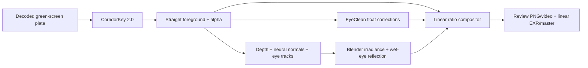

# Architecture

The pipeline changes illumination on observed pixels. Single-view depth and normal estimates
supply geometry, not generated actor texture.

The primary relation is `foreground ? E_target / E_source`. Source illumination is estimated
from the actor and neural normals. The proxy renders neutral diffuse/subsurface transport
and shadows; its visible texture never enters the composite.

Below the proxy's measured spatial bandwidth, per-light normal modulation supplies surface
relief. A physically scaled GGX/Smith/Schlick term adds skin specular, widened by source size,
with the accepted conservative gain and photographic texture modulation.

EyeClean executes separately because its Python/PyTorch/CUDA stack differs from both the
keyer and the normals pipeline. Float corrections enter before relighting. Each patch run
binds its frame indices to the exact foreground files. Scene reflections enter afterward in
the ratio's exposure-anchor units, through fitted lids and wet-eye geometry. An abstaining
eye keeps its original pixels and gets no added reflection.

The Blender tour uses a corneal cap, scleral globe, limbal transition and head-attached socket.
They account for source size, direction and occlusion. Reflections are rendered images of
scene sources, never painted dots.

## Boundaries

- `src/ngsr/`: installable adapters, patch application and stage launcher.
- `scripts/key_plate.py`: CorridorKey 2.0 adaptation to the established shot layout.
- `scripts/neural_normals.py`, `video_depth.py`, `make_proxy_mesh.py`: neural geometry.
- `scripts/stress_proxy.py`, `render_eye_catchlight.py`: Blender example renderers.
- `scripts/composite_ratio.py`, `meso_specular.py`, `gpu_image.py`: composition/shading.
- `scripts/eye_*.py`, numbered audits/reviews and `docs/r*.md`: historical eye research;
  not the new removal API.
- `music_videos/`, `scene_library/`, `logs/`: development fixtures/evidence, not package data.

The stage launcher exposes the existing implementation without copying it into another
package. A future fully standalone compositor API can extract those kernels once the
file contracts and artist comparison are accepted.

## Limits that remain

The proxy is a displaced shell, not a recovered actor. Normals are temporally noisy and
lack microstructure. Captured hair/lip highlights cannot move under a diffuse lighting ratio.
EyeClean can abstain; a separate, optional accepted sclera pass removes white-of-eye glints while preserving EyeClean's edited pixels.
Camera match and source-light recovery retain assumptions. The bulb tour is a black void:
its render convergence does not establish bounce-light accuracy in a furnished environment.
