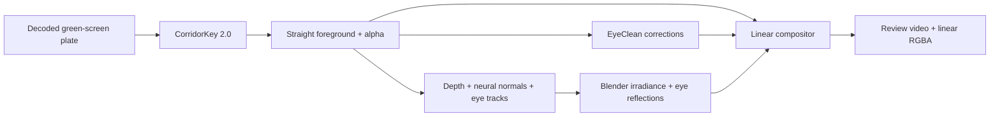

# Architecture

The compositor multiplies the photographed foreground by a lighting ratio:

```
relit = foreground * E_target / E_source
```

`E_source` is estimated from the plate and neural normals. Blender renders `E_target`
on a neutral proxy with diffuse/subsurface shading and shadows. The proxy's texture
doesn't enter the composite.



Where the proxy loses facial detail, per-light meso shading uses the neural normals.
The compositor measures the scale at which the proxy and normal fields resolve the same
amount of relief. A GGX/Smith/Schlick lobe adds skin specular; the light's size broadens it,
and texture from the plate breaks up the smooth band.

EyeClean runs in a separate process because its Python, PyTorch and CUDA versions differ
from the keyer and normals pipeline. Its float corrections are applied before the ratio.
Each run records the foreground hashes. The optional sclera pass adds corrections outside
EyeClean's edited pixels.

Blender renders eye reflections on a corneal cap, scleral globe and limbal transition,
with a socket attached to the head for occlusion. The compositor adds these reflections
after the ratio, using the same exposure scale and fitted eyelids. It skips eyes that
EyeClean left untouched.

## Code layout

| Location | Purpose |
|---|---|
| `src/ngsr/` | Engine adapters, float patch reader and stage launcher |
| `scripts/key_plate.py` | CorridorKey 2.0 output, core preservation and despill |
| `neural_normals.py`, `video_depth.py`, `make_proxy_mesh.py` in `scripts/` | Geometry |
| `stress_proxy.py`, `render_eye_catchlight.py` in `scripts/` | Blender example renders |
| `composite_ratio.py`, `meso_specular.py`, `gpu_image.py` in `scripts/` | Compositing and shading |
| Older `scripts/eye_*.py`, numbered audits and `docs/r*.md` | Eye-repair experiments that preceded EyeClean |
| `music_videos/`, `scene_library/`, `logs/` | Development shots, scenes and measurements |

The launcher calls scripts in the checkout. Keep the checkout alongside the adapter wheel
to run geometry, rendering and compositing.

## Limits

The proxy is a displaced shell. It approximates shadow shape, and the normals lack pore
detail and can vary between frames. A diffuse lighting ratio leaves photographed hair
and lip highlights in place.

Camera matching and source-light estimation retain assumptions. The bulb-tour scene has
no walls or floor, so its convergence tests say little about bounce light in a furnished room.
